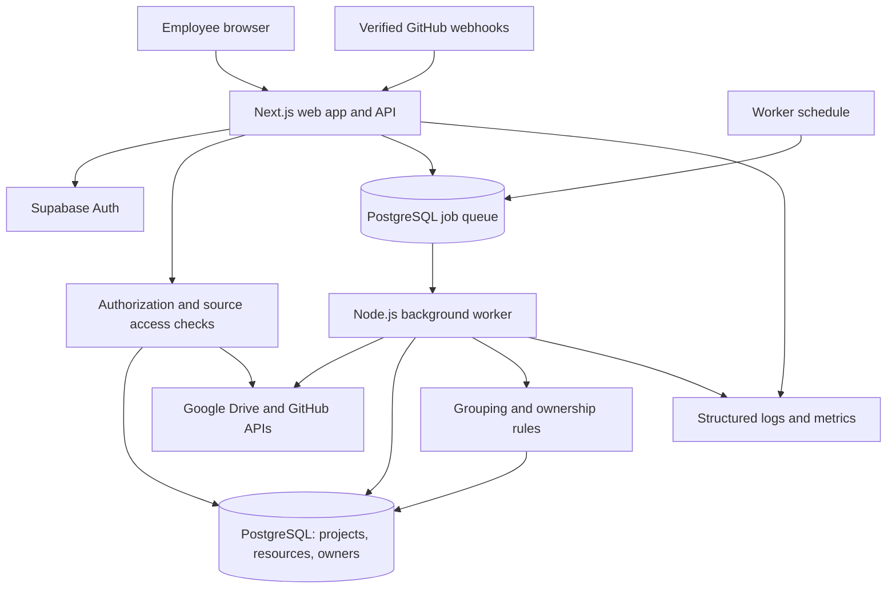
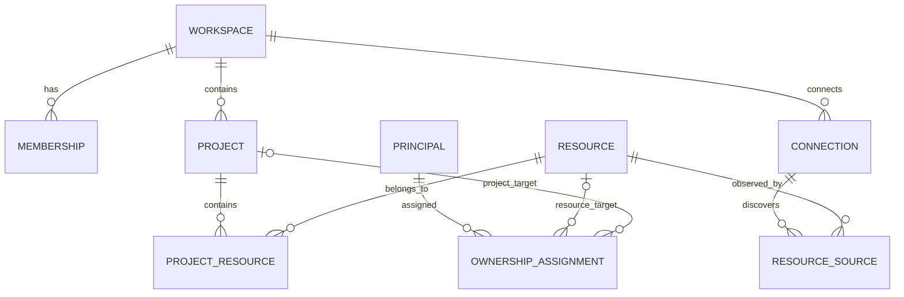

# Findat MVP architecture

Status: proposed production/pilot architecture. The repository also contains a runnable, single-user local MVP with a narrower feature set; see the root README for its exact capabilities and limits.

## 1. Product goal and pilot boundary

Findat should let an employee open a project and answer three questions: where are its resources, who is responsible for them, and when was that information last checked?

Build a shared project directory with a persistent relationship map. The first release should demonstrate the full loop: connect sources, import resources, suggest project membership and owners, let a person correct those suggestions, and preserve those corrections during later syncs.

Planning assumptions: two developers; one team of up to 25 users per customer; initially 3-5 pilot customers; up to 20 projects and 2,000 imported resources per workspace. These are scope limits to validate, not measured capacity. Start with one Google Workspace organization and one GitHub organization per workspace. An invite determines workspace membership; matching an email domain alone does not grant access.

| Include in the pilot | Scope |
| --- | --- |
| Workspaces and invitations | Owner, editor, and viewer roles |
| Google Drive integration | Selected folder trees; file metadata and links |
| GitHub integration | Selected repositories; metadata and CODEOWNERS |
| Project directory and detail page | Resource list, responsible people/teams, freshness, small relationship diagram |
| Search | Project names, resource titles, tags, confirmed owners; source/type filters |
| Suggestions and corrections | Approve or reject a resource grouping; confirm or replace an owner |
| Review inbox | Unconfirmed owners, overdue reviews, broken integrations |
| Manual resources | Explicitly shared links to dashboards, datasets, Slack, Jira, or Figma |
| Pilot measurement | Task completion, correction activity, sync reliability, operating cost |

Defer Slack/Jira ingestion, browser extensions, natural-language chat, full document indexing, dataset inspection, automatic billing, and company-wide discovery. Manually added dataset links do not imply a warehouse integration or verified data lineage. The project diagram is a navigational view of saved relationships.

## 2. System design

Use a modular monolith: one codebase, one web process, one background worker, and one PostgreSQL database. The worker runs separately so slow imports and retries do not occupy web requests. Both processes share domain types and authorization code.



| Component | Proposed choice | Reason |
| --- | --- | --- |
| UI and application API | Next.js, React, TypeScript | One language and deployment for pages and request handlers |
| Styling | Tailwind CSS and a small shared component library | Consistent forms, tables, and status labels |
| Authentication | Supabase Auth, initially Google sign-in | Managed sessions; provider authorization is a separate consent flow |
| Database | Supabase PostgreSQL, Drizzle migrations | Relational project map, tenant isolation, search, durable jobs |
| Search | PostgreSQL full-text search with a GIN index | Adequate starting point for the pilot resource limit |
| Background execution | Node.js worker with a PostgreSQL jobs table | Durable processing using the existing database |
| Hosting | Render web service and background worker; Supabase database | Separate lifecycles for requests and imports |
| Relationship diagram | React-rendered SVG with a fixed project-centered layout | Small, accessible diagram without a graph database |
| AI | Optional suggestion adapter, disabled for the first slice | Establish correction quality and costs before introducing model dependency |

Render documents background workers as continuously running services. PostgreSQL supplies full-text indexes. These support the proposed deployment; the exact hosting plans and pinned dependency versions should be selected when implementation begins. [Render service types](https://render.com/docs/service-types), [PostgreSQL text-search indexes](https://www.postgresql.org/docs/current/textsearch-indexes.html).

## 3. Main user experience

1. A workspace owner signs in, creates a workspace, and invites the pilot team.
2. The owner authorizes the selected source connections and chooses folder roots and repositories.
3. Findat imports a bounded set of resources and displays import progress and integration errors.
4. The owner creates a project, maps a folder/repository to it, and reviews initial grouping suggestions.
5. Employees connect their own source accounts to view imported resources they can access.
6. A user searches or opens a project and sees accessible resources, confirmed owners, and review dates.
7. An editor or the proposed owner confirms or corrects ownership; the change is recorded immediately.
8. Background sync updates metadata without replacing confirmed ownership. Reviews appear in an in-app inbox.

The main screens are Projects, Project detail, Search, Review inbox, and Settings/Connections. On project detail, use the resource table as the main view and a compact map as a secondary view. Distinguish `Suggested`, `Confirmed`, and `Unknown` ownership in both.

## 4. Data model

All customer-owned rows carry `workspace_id`. Use composite foreign keys containing `workspace_id` so a relationship cannot join records from different tenants. IDs are UUIDs; provider IDs remain strings.

| Table | Key data and responsibility |
| --- | --- |
| `workspaces` | Name, settings, retention settings |
| `memberships` | Workspace, auth user, role, status; unique workspace/user |
| `invitations` | Hashed token, intended email, role, expiry, accepting user |
| `principals` | Workspace-local person or team; optional linked auth user |
| `external_identities` | Principal, provider, stable provider subject; verified identity mapping |
| `connections` | Provider, installation/account ID, selected roots/repos, status, last successful sync |
| `credentials` | Connection or viewer, encrypted tokens, scopes, expiry, key version; private server access |
| `projects` | Name, summary, tags, lifecycle status, creator |
| `resources` | Provider namespace and ID, type, title, URL, modified time, sync time, availability |
| `resource_sources` | Resource/connection association, source version, observed presence; supports deduplication across connections |
| `project_resources` | Project/resource edge, suggested or confirmed state, method, approver |
| `ownership_assignments` | Project OR resource target, principal, suggested/confirmed/rejected state, evidence IDs, version, confirmation date |
| `reviews` | Target, reason, due date, assigned principal, status; avoids duplicate open reviews |
| `sync_cursors` | Connection and stream, pagination/change cursor, scope version |
| `jobs` | Type, workspace, dedupe key, payload IDs, status, attempts, lease expiry, next run |
| `audit_events` | Actor, action, target IDs, timestamps, safe before/after fields |
| `product_events` | Event type, actor ID, project/resource IDs where necessary, timings; no document text or raw search query |



Enforce exactly one target on each ownership row with a database CHECK constraint. Index resource identity on `(workspace_id, provider, provider_namespace, external_id)` and relationship pairs on their workspace/target IDs. Keep one active confirmed primary owner per target using partial unique indexes; additional contacts are a separate future capability. A GitHub team can be a principal even when its members have not been mapped to Findat users.

## 5. Permissions and identity

Workspace membership permits viewing deliberately published project names, summaries, and manual links. Source-derived fields require source authorization too. Confirming a project-level description or owner explicitly publishes that information to the workspace; imported resource ownership and its evidence remain restricted to viewers of that resource.

Every imported-resource request follows this path:

1. Verify the session and active workspace membership on the server.
2. Retrieve tenant-scoped candidate IDs privately; do not return raw database rows.
3. Check each candidate with the viewer's provider credentials. For Drive, use a metadata request for that file. For GitHub, verify repository access using a GitHub App user access token.
4. Return only allowed resources and ownership evidence. Apply the same filtering to autocomplete, diagrams, previews, review items, exports, and counts.

Initial release: reuse an access result only within the same request. Do not persist positive access decisions across requests. Bound checks with pagination and concurrency limits; do not compute a total count from unfiltered candidates. If a provider is unavailable, fail closed for that provider and show a generic connection status. A missing viewer connection prompts that user to connect their account without revealing hidden item names. Do not let a connector admin's credential authorize another employee's view.

A GitHub App user token is limited by both the app's and the user's access, which makes it appropriate for viewer checks. Installation credentials are used for ingestion. [GitHub user access tokens](https://docs.github.com/en/apps/creating-github-apps/authenticating-with-a-github-app/generating-a-user-access-token-for-a-github-app).

Keep imported metadata, search indexes, credentials, and jobs in a private database schema with no browser/Data API access. Server transactions use a dedicated database role without `BYPASSRLS` and set the verified workspace context locally for that transaction. Enable and force tenant policies; use separate migration credentials. Supabase privileged credentials can bypass row security and must remain server secrets. Workspace isolation does not replace provider access checks. [Supabase row security](https://supabase.com/docs/guides/database/postgres/row-level-security).

Encrypt refresh tokens with an authenticated cipher and a deployment secret outside the database; store a key version for rotation. Validate OAuth state, bind callbacks to the initiating session, use PKCE where supported, verify webhook signatures, and prevent credentials entering logs. Invite acceptance must match the signed-in verified email. Require explicit account linking; do not infer a person's identity from a matching display name.

## 6. Connector design and synchronization

Both connectors implement `validateConnection`, `initialScan`, `incrementalSync`, `fetchMetadata`, and `checkViewerAccess`. Keep pagination, rate limits, and provider-specific fields inside the adapters.

### Google Drive

Use `drive.metadata.readonly` for metadata-only import and viewer checks. Store file IDs, titles, MIME types, parent relationships, URLs, modified times, and ownership signals. A selected folder is an application ingestion boundary, not a limitation on the OAuth token's scope. Show that distinction during connection setup.

Google currently classifies this scope as restricted; external deployment may require verification and assessment depending on the app's use. Resolve that with the pilot organization before committing to its onboarding date. `drive.file` is a narrower file-by-file alternative, but it permits writes and should not be described as a read-only equivalent for crawling existing folders. If integration approval is pending, use explicit manual links and clearly label the demo's lack of automatic sync. [Drive scopes](https://developers.google.com/workspace/drive/api/guides/api-specific-auth).

Capture a start token before initial traversal, import the selected roots recursively, then consume changes since that token. Persist the cursor only after that page's changes commit. Poll incrementally every 15 minutes as a starting target. Apply selected-root filtering to changes and perform a daily bounded reconciliation to catch folder moves and newly included descendants. Support shared-drive parameters or explicitly reject unsupported selections. [Drive change retrieval](https://developers.google.com/workspace/drive/api/guides/manage-changes), [shared-drive support](https://developers.google.com/workspace/drive/api/guides/enable-shareddrives).

### GitHub

Use a GitHub App installed on selected repositories, with Metadata read and Contents read. Contents permission supports reading CODEOWNERS, although it authorizes more repository content than Findat needs; the adapter must fetch only the documented paths. Store repository metadata and bounded CODEOWNERS data, not source code. A CODEOWNERS entry is evidence for a path's code reviewer, not proof of overall project ownership.

Process signed installation, repository, and push events as invalidation hints; enqueue jobs and refetch current source state. Periodically reconcile repository access and metadata to recover missed events. Restrict installation tokens to configured repositories where supported and refresh expiring tokens. [GitHub App permissions](https://docs.github.com/en/apps/creating-github-apps/registering-a-github-app/choosing-permissions-for-a-github-app), [installation tokens](https://docs.github.com/en/apps/creating-github-apps/authenticating-with-a-github-app/generating-an-installation-access-token-for-a-github-app).

### Worker behavior

The worker claims jobs with a short transaction and `FOR UPDATE SKIP LOCKED`, assigns a renewable lease, then makes network calls outside the transaction. Delivery is at least once. Upserts, unique dedupe keys, and transactional cursor advancement make replay safe. Coalesce sync requests per connection; retry rate limits and transient failures with jitter and provider retry headers. After five failed attempts, retain the failed job for explicit retry and expose a safe error status to the owner.

Treat 401/403 as authorization problems, 429/5xx as retryable, and removed resources as unavailable observations. A connection losing access does not prove a resource was deleted globally. Hide resources without any valid source association, invalidate affected suggestions, and preserve manually entered project context. On disconnect, disable reads/jobs immediately; purge credentials and source-derived records within a documented 24-hour target unless another active connection still supplies that resource. Include database backup expiry in the customer data-retention policy.

## 7. Project grouping, ownership, and freshness

Begin with explainable rules:

| Signal | Result |
| --- | --- |
| Editor maps a folder or repository to a project | Save a confirmed mapping anchor |
| Newly imported resource falls under a mapped root | Add a grouping suggestion using that anchor |
| Resource title matches a project alias | Suggest a possible grouping; require approval |
| GitHub CODEOWNERS contains an explicit broad path rule | Suggest a code-owner contact with the exact path evidence |
| Drive metadata identifies a file owner or recent modifier | Suggest a possible contact with a weak-evidence label |
| Authorized user confirms a responsible person/team | Save confirmed ownership with who confirmed it and when |

File ownership, activity, and code review responsibility are distinct from business responsibility. Multiple candidates should result in an unresolved suggestion, not an arbitrary winner. Start with `strong`, `weak`, and `unknown` evidence labels; avoid displaying uncalibrated percentages.

An editor can manage ownership. A proposed owner can accept or decline their own assignment. Other viewers may submit corrections for review. Record the previous value, actor, evidence, timestamp, and version. Use optimistic concurrency; stale writes return 409. Subsequent ingestion can create a review request but must never overwrite a confirmed decision or repeatedly recreate a rejected suggestion for unchanged evidence.

Freshness has three separate timestamps: `source_modified_at`, `last_synced_at`, and `last_confirmed_at`. A document's age does not prove its content is wrong. Display factual labels such as "Edited 40 days ago," "Synced 12 minutes ago," and "Owner confirmed 8 days ago." Initially prompt an ownership review after 30 days and a resource review after 90 days without confirmation; make thresholds configurable. A sync outage produces an integration warning, not a claim that every resource is stale.

Optional later AI: pass only minimal approved metadata to a workspace-specific suggestion job, require structured IDs and evidence, validate every output against that workspace, and preserve human approval. Set per-workspace usage limits and record actual input/output usage. Treat imported text as untrusted data. AI must not grant access, publish ownership, or sit on the search request path.

## 8. API boundaries

All endpoints verify session, workspace, and role; all imported-resource responses pass through the source-access filter. Clients cannot select a trusted actor or workspace context through arbitrary request fields.

| Endpoint | Behavior |
| --- | --- |
| `POST /api/workspaces` | Create workspace and initial owner membership transactionally |
| `POST /api/invitations` | Create an expiring invitation for a specified role |
| `POST /api/connections/:provider/start` | Begin OAuth or installation flow |
| `GET /api/connections/:provider/callback` | Validate callback and store credentials server-side |
| `PATCH /api/connections/:id` | Select allowed roots/repos; invalidate old sync scope |
| `POST /api/connections/:id/sync` | Owner requests a deduplicated job; return 202 and job ID |
| `DELETE /api/connections/:id` | Disable connection and enqueue purge |
| `GET, POST /api/projects` | List published projects or create one |
| `GET, PATCH /api/projects/:id` | View authorized map or edit project context |
| `POST /api/projects/:id/resources` | Add a manual link or approve a resource edge |
| `GET /api/search?q=...` | Cursor-paginated, permission-filtered search |
| `POST /api/ownership/:id/decision` | Confirm, reject, or replace; include expected version |
| `GET /api/reviews` | Return only reviews the viewer may see |
| `POST /api/webhooks/github` | Verify signature, deduplicate delivery, enqueue refresh |

Accept HTTPS manual links, escape display text, and do not fetch arbitrary URLs for previews. The submitter explicitly shares the link and supplied title with the workspace; label it "Access and freshness not verified." Validate request shapes and use parameterized database operations. UI mutations use same-origin session protections.

## 9. Deployment, operations, and cost

Create separate development, staging, and pilot environments with separate databases and OAuth applications. Store secrets in deployment configuration, use TLS, run schema migrations through a dedicated release step, and back up the pilot database with a documented restore procedure. Pin supported dependencies when scaffolding.

Measure sync duration/lag, queued and failed jobs, viewer-check latency, search completion, authorization denials, provider throttling, and operating costs per workspace. Log IDs and error codes rather than tokens, resource titles, or query text. Alert on repeated connector failure, expired job leases, or sync lag above one hour. Treat the proposed 15-minute sync interval and 3-second search p95 as targets to validate with real provider latency.

Cost model:

`monthly cost = web hosting + worker hosting + database/backups + auth overages + monitoring + optional model usage`

`cost per active seat = monthly cost / active seats`

At the proposal's $12/seat/month price, a 75% gross margin permits $3/seat/month in total cost of service. At 100 paid seats that is $300/month; at 25 seats it is $75/month. Include hosting, processing, and service-related support in the calculation, not only model input tokens. Free pilots have no revenue margin to measure. Track actual spend and use current vendor quotes before choosing paid plans; this document does not assume the proposal's model name or token-price estimate is verified.

## 10. Delivery sequence and acceptance criteria

Indicative schedule for two developers: 4-6 weeks after provider access is available. Scope or review delays can extend it.

| Milestone | Deliverable | Acceptance criterion |
| --- | --- | --- |
| 1: Core loop | Auth, tenant schema, seeded projects, manual resources, ownership edits | An invited user finds a project and an editor's correction persists across sessions |
| 2: First live source | Drive connection, bounded import, viewer access checks | Two users with different source access receive appropriately different results |
| 3: Cross-source map | GitHub connector, grouping suggestions, CODEOWNERS evidence | One project links accessible Drive and GitHub resources and distinguishes suggestions from confirmations |
| 4: Reliable updates | Incremental sync, job recovery, deletions, review inbox | Source changes appear after sync; confirmed ownership survives reimports |
| 5: Pilot release | Measurement, onboarding, operations, failure handling | Meet the release gates below with an actual pilot-sized dataset |

Release gates to implement and verify:

- Cross-workspace requests and cross-workspace foreign keys fail, including guessed IDs.
- A revoked source permission hides names, links, evidence, counts, and diagram nodes on the next request.
- Duplicate webhooks, expired worker leases, and interrupted scans do not create duplicates or lose committed progress.
- Source outages produce recoverable status; they do not expose cached unauthorized metadata.
- Ownership corrections survive resync, and simultaneous edits do not silently overwrite each other.
- Disconnect disables access immediately and completes the documented data purge.
- A scheduled job can recover after worker restart, and a staging backup can be restored.

Pilot product targets: at least 80% of a set of real resource-and-owner lookup tasks completed within one minute; report task count and median/p90 completion time. Measure setup time separately from provider approval time, targeting under one hour of admin work. Track the share of suggestions accepted, corrected, and ignored over a week to test whether the ownership map actually gets maintained. Compare the same lookup tasks with each team's existing workflow and collect willingness-to-pay separately. These are experiment targets, not evidence that the proposal's hypotheses are confirmed.

## 11. Suggested repository structure

```text
apps/
  web/                   # Next.js pages and API routes
  worker/                # Sync, reconciliation, review scheduling, purge jobs
packages/
  domain/                # Project, resource, ownership, and review services
  authz/                 # Workspace roles and source-access response filtering
  db/                    # Schema, migrations, tenant-scoped transactions
  connectors/
    google-drive/
    github/
  contracts/             # Input/output schemas and shared types
  ui/                    # Forms, resource rows, badges, project map
docs/
  MVP_ARCHITECTURE.md
```

The local MVP now implements the single-user project, manual-resource, and confirmed-owner loop, plus public GitHub metadata import. Its frontend is React with Vite, and its API uses the Node.js standard library with SQLite. The next pilot slice is workspace authentication and viewer authorization, followed by automatic Drive import and private GitHub access. The proposed hosted stack above is a target for that pilot; the current app runs locally without external accounts.

## Proposal basis

This architecture translates the November 8, 2026 Findat Prototype II proposal into an initial build plan. It deliberately narrows automated integrations and inference for a pilot. The original proposal remains the source for the product concept, target segment, pilot size, proposed price, and research hypotheses; technology choices, data structures, limits, schedules, and release criteria above are proposed engineering decisions.
